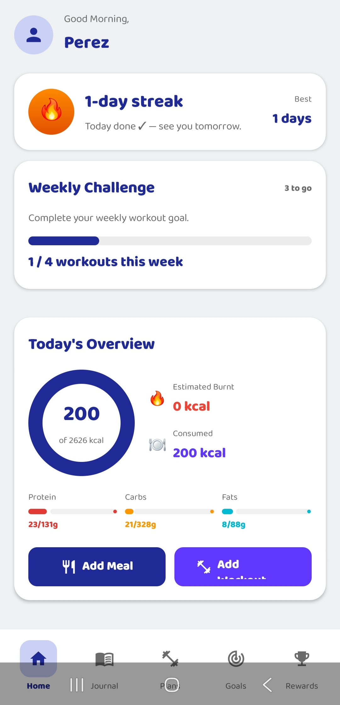
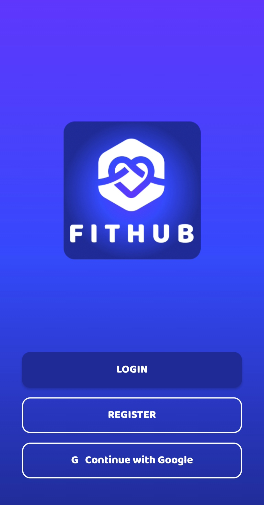
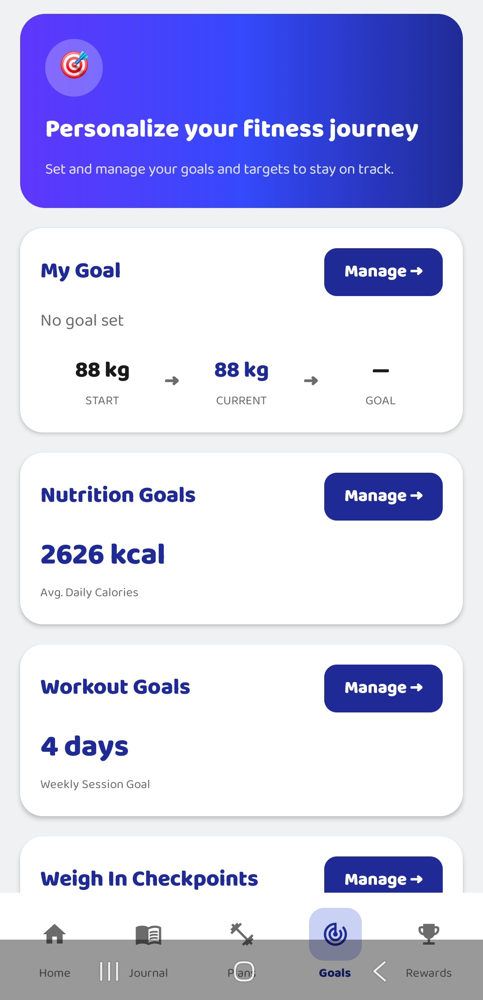
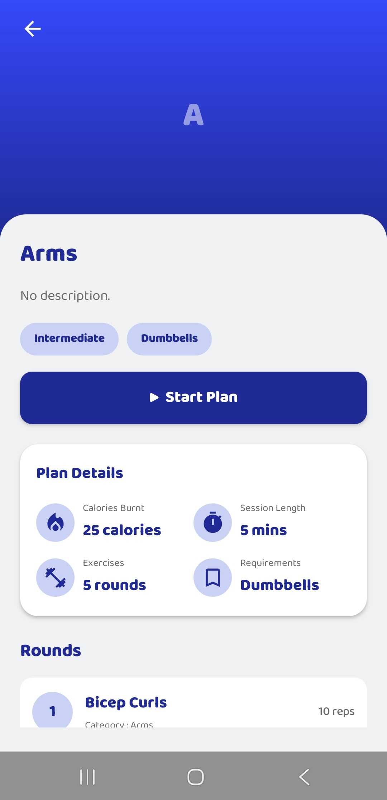
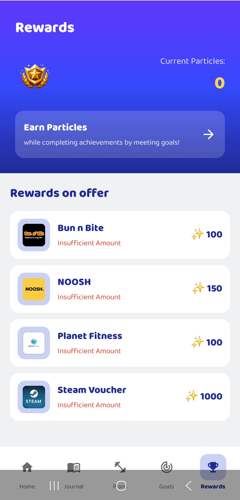
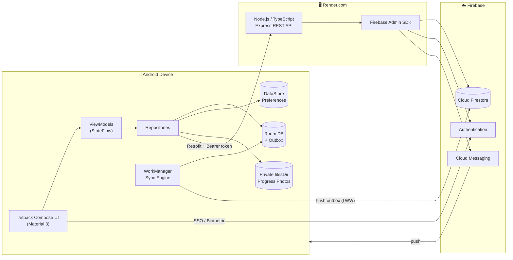
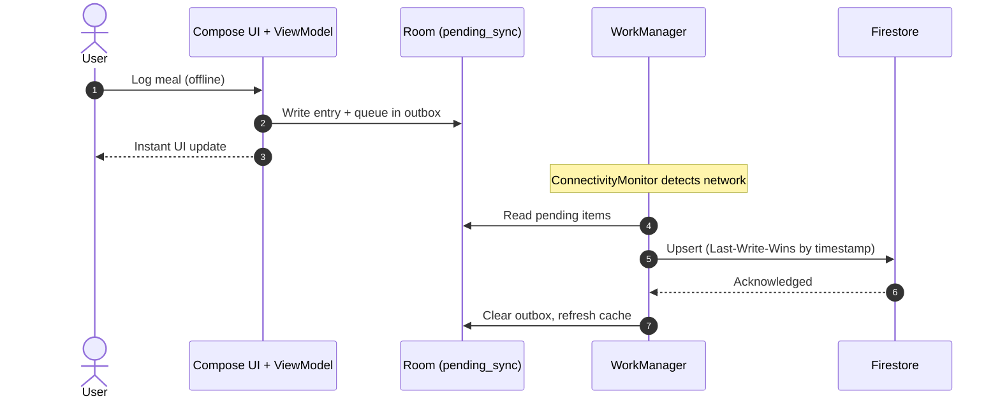
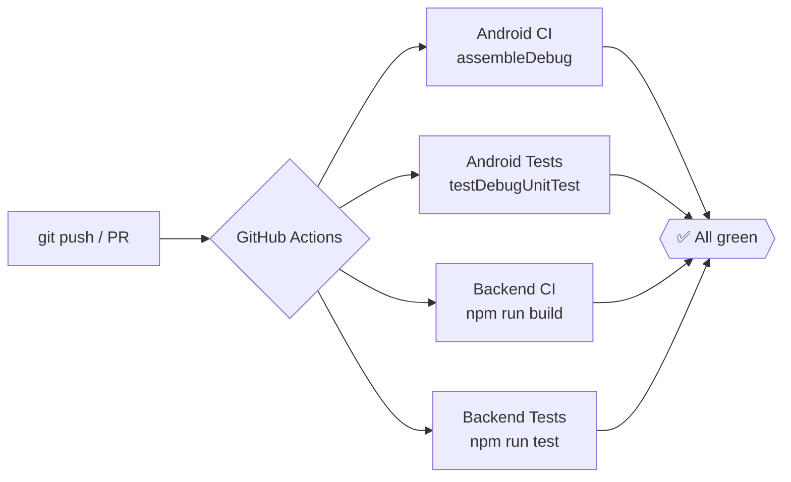

<!-- ═══════════════════════════ HEADER ═══════════════════════════ -->
<div align="center">


<br/>


<br/><br/>

<a href="YOUR_YOUTUBE_LINK_HERE">
  
</a>

</div>

<br/>

<!-- ═══════════════════════════ NAV ═══════════════════════════ -->
<div align="center">

[**Showcase**](#showcase) &nbsp;•&nbsp;
[**Highlights**](#highlights) &nbsp;•&nbsp;
[**Architecture**](#architecture) &nbsp;•&nbsp;
[**Features**](#features) &nbsp;•&nbsp;
[**REST API**](#rest-api) &nbsp;•&nbsp;
[**Security**](#security) &nbsp;•&nbsp;
[**CI/CD**](#cicd--testing) &nbsp;•&nbsp;
[**Get Started**](#getting-started)

</div>

---

<a id="demo"></a>
## 🎥 Final POE Demonstration

<div align="center">

<a href="YOUR_YOUTUBE_LINK_HERE">
  
</a>

**A full walkthrough on a physical Android device**

`Google SSO` · `Biometric Lock` · `Offline Sync` · `Push Notifications` · `Multi-language` · `Custom REST API`

</div>

---

<a id="showcase"></a>
## 📱 Showcase

<div align="center">

|  |  |  |
|:---:|:---:|:---:|
| **🔐 Secure Access**<br/><sub>Biometric & Google SSO</sub> | **📊 Live Insights**<br/><sub>Server-aggregated dashboard</sub> | **🎯 Health Metrics**<br/><sub>BMI & goal tracking</sub> |

|  |  |  |
|:---:|:---:|:---:|
| **🏋️ Explore**<br/><sub>Verified workout plans</sub> | **⏱️ Train**<br/><sub>Active session tracking</sub> | **✅ Achieve**<br/><sub>Completion summary</sub> |

|  |  | |
|:---:|:---:|:---:|
| **🎉 Engage**<br/><sub>Particle reward system</sub> | **🎨 Brand**<br/><sub>Adaptive app icon</sub> | |

</div>

> 💡 **Tip:** Rename the files in `/images` to remove spaces (e.g. `Active_Workout.jpg`) for the most reliable rendering on GitHub.

---

<a id="highlights"></a>
## ✨ Highlights

<table>
<tr>
<td width="33%" valign="top">

### 📴 Offline-First
Log meals and workouts with zero connectivity. An **Outbox pattern** on Room queues every write and a **WorkManager** engine syncs it when the network returns.

</td>
<td width="33%" valign="top">

### 🔐 Defence in Depth
Credential Manager SSO, **biometric gating**, Firestore rules scoped to `request.auth.uid`, and short-lived ID tokens on every API call.

</td>
<td width="33%" valign="top">

### ☁️ Custom Backend
A bespoke **Node.js + TypeScript + Express** API on Render performs server-side aggregation and admin-only FCM broadcasts.

</td>
</tr>
<tr>
<td width="33%" valign="top">

### 🌍 Localised
Full i18n in **English**, **isiZulu** and **Afrikaans**, plus Material 3 dynamic colour and dark mode.

</td>
<td width="33%" valign="top">

### 🔥 Habit Engine
`StreakCalculator` and weekly challenges turn consistency into milestone **particle rewards**.

</td>
<td width="33%" valign="top">

### 📸 Private Progress
A "Before vs Now" photo timeline stored **only** in private internal storage; no cloud storage costs, no privacy leakage.

</td>
</tr>
</table>

---

<a id="architecture"></a>
## 🏗️ Architecture

FitHub follows a **layered MVVM** design with **Unidirectional Data Flow**, keeping UI, state and data concerns cleanly separated and independently testable.

### System Overview



### Offline Sync Flow



### Tech Stack

| Layer | Technology |
|---|---|
| **UI** | Kotlin · Jetpack Compose · Material 3 · Navigation Compose |
| **State** | ViewModel · `StateFlow` · Unidirectional Data Flow |
| **Local** | Room (SQLite) · DataStore · private `filesDir` storage |
| **Networking** | Retrofit · OkHttp `AuthInterceptor` |
| **Cloud** | Firebase Auth · Cloud Firestore · Firebase Cloud Messaging |
| **Background** | WorkManager · `ConnectivityMonitor` |
| **Backend** | Node.js 22 · TypeScript · Express · Firebase Admin SDK · Render |
| **Quality** | JUnit (JVM) · `node:test` · GitHub Actions |

---

<a id="features"></a>
## 🧩 Features

<details open>
<summary><b>🔑 Phase 1–2 · Authentication & Foundation</b></summary>

<br/>

- **Google SSO** via the modern **Credential Manager API**, linked to Firebase Authentication.
- **Biometric authentication** (fingerprint / face) using `androidx.biometric`.
- **Native Jetpack Compose** UI built on strict Unidirectional Data Flow.

</details>

<details open>
<summary><b>🔄 Phase 3–4 · Offline Architecture & Sync</b></summary>

<br/>

- **Outbox pattern:** offline writes land in a Room `pending_sync` table.
- **WorkManager sync engine:** reacts to `ConnectivityMonitor`, flushes the queue to Firestore, then refreshes the local cache.
- **Push notifications:** FCM server-to-client messaging with custom channels, deep links and local WorkManager daily-checkpoint reminders.

</details>

<details open>
<summary><b>🌍 Phase 5 · Localisation & UX</b></summary>

<br/>

- **Languages:** English 🇬🇧 · isiZulu 🇿🇦 (`zu`) · Afrikaans 🇿🇦 (`af`)
- **Theming:** system dark mode with Material 3 dynamic colour tokens.
- **Design system:** reusable components (`RoundedCard`, `NumberStepper`, `ProgressBar`).

</details>

<details open>
<summary><b>🔥 Phase 6 · User Defined Features (UDFs)</b></summary>

<br/>

| UDF | Feature | Details |
|:---:|---|---|
| **4** | **Daily Streaks & Weekly Challenge** | `StreakCalculator` parses food and workout logs to compute the active streak; milestones trigger particle rewards. |
| **5** | **Progress Photo Timeline** | "Before vs Now" gallery. Photos attach to weigh-ins, are compressed by `ImageCompressor` and stored in private local storage. |

</details>

<details open>
<summary><b>🖥️ Phase 6B · Custom Hosted REST API</b></summary>

<br/>

See the dedicated [REST API](#rest-api) section below.

</details>

---

<a id="rest-api"></a>
## 🌐 REST API

A fully deployed **Node.js / TypeScript / Express** service on **Render.com**. Every protected route verifies a Firebase ID token through the Admin SDK.

| Method | Endpoint | Auth | Purpose |
|:---:|---|:---:|---|
| `GET` | `/api/v1/me/summary` | 🔒 User | Server-side aggregation of weekly calories, weight trend and streaks into one lightweight JSON payload. |
| `POST` | `/api/v1/admin/broadcast` | 🛡️ Admin | Sends an FCM notification to all users. Gated by custom Firebase admin claims. |

**Request shape**

```http
GET /api/v1/me/summary HTTP/1.1
Authorization: Bearer <firebase-id-token>
```

The Android client's Retrofit `AuthInterceptor` attaches a fresh, short-lived ID token to every call automatically.

---

<a id="security"></a>
## 🔐 Security & Data Integrity

| Control | Implementation |
|---|---|
| **Identity & Access** | Firestore rules enforce `request.auth.uid == userId`; users can only touch their own subcollections. |
| **Biometric Gating** | The Firebase session is retained on cold start only when biometric lock is enabled; the UI stays behind `BiometricPrompt`. |
| **Token Auth** | Retrofit `AuthInterceptor` injects a short-lived ID token as `Authorization: Bearer`. |
| **Admin Privilege** | Broadcast endpoint requires a custom Firebase claim verified server-side. |
| **Offline Integrity** | Outbox queue + Last-Write-Wins reconciliation prevents data loss on network drops. |
| **Media Privacy** | Progress photos are compressed and kept in private internal storage only. |
| **Compliance** | Designed around **POPIA**: sensitive data processed locally first, with explicit consent before cloud sync. |

---

<a id="cicd--testing"></a>
## ⚙️ CI/CD & Testing



| Area | Coverage |
|---|---|
| **Backend** | 50+ tests with `node:test` covering endpoints, validation and token auth (via an in-memory `MemoryStore`). |
| **Android (JVM)** | `StreakCalculator`, `WeeklyChallengeCalculator`, `CalorieEngine`, `SyncManager`. |
| **Repository health** | 75+ structured, conventional commits with clear branch management. |

---

## 🚀 Release & Play Store Readiness

- ✅ **Signed release build:** `app-release.apk`, compiled with a secure keystore
- ✅ **Store assets:** 1080×1920 screenshots, high-res icon and feature graphic in `/images`
- ✅ **Privacy-first:** POPIA-aligned data handling
- ✅ **Release notes:** full v1 → **v3.0.0** history in [`RELEASE_NOTES.md`](RELEASE_NOTES.md)

---

<a id="getting-started"></a>
## 🛠️ Getting Started

### Prerequisites

| Tool | Version |
|---|---|
| [Android Studio](https://developer.android.com/studio) | Koala or newer |
| [JDK](https://adoptium.net/temurin/releases/?version=17) | 17 |
| Node.js | 22+ *(only for running the backend locally)* |
| Device | Android 8.0 (API 26)+; physical device recommended for biometrics, FCM and camera |

### Setup

```bash
# 1. Clone
git clone https://github.com/ST10448618/Fithub-PROG7314.git
cd Fithub-PROG7314
```

```bash
# 2. Add Firebase config
#    Download google-services.json from the Firebase Console into app/
cp /path/to/google-services.json app/
```

```bash
# 3. Build the Android app
./gradlew assembleDebug

# Run unit tests
./gradlew testDebugUnitTest
```

<details>
<summary><b>Run the backend locally (optional)</b></summary>

<br/>

```bash
cd backend
npm install
npm run dev      # start in watch mode
npm run build    # compile TypeScript
npm run test     # run the node:test suite
```

</details>

---

<div align="center">

**PROG7314 · Programming 3D · Final POE · 2026**

<sub>Built with Kotlin, Compose and a lot of ☕</sub>


</div>
